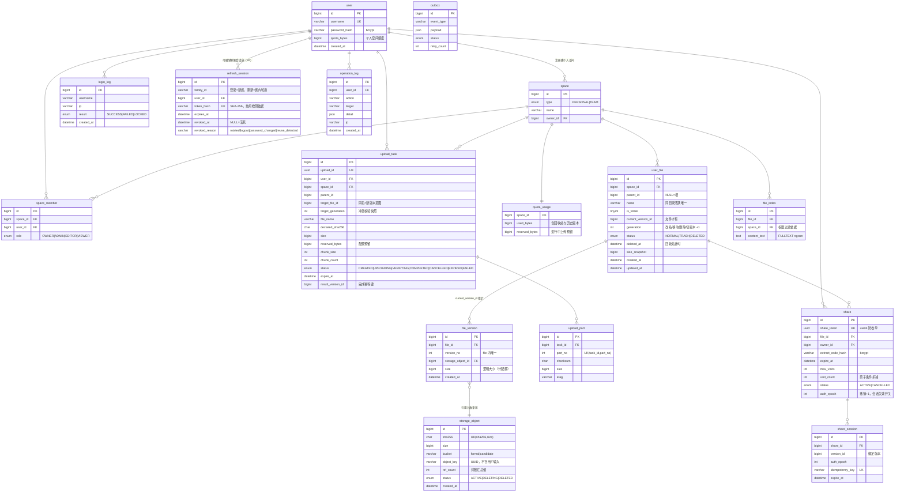

# ER 图（初稿，M0）

> 数据模型三层的核心思想：**逻辑文件（user_file）→ 版本（file_version）→ 物理对象（storage_object）**。
> 版本是引用计数的事实来源；物理对象按服务端核验的 (sha256, size) 全局去重。
> 本图为设计初稿，随 M1–M8 里程碑逐表落地并修订。

## 关键约束（落地时逐一实现）

1. `space_member` 唯一 `(space_id, user_id)`；注册事务内建个人空间 + OWNER 成员。
2. `user_file` 同目录活跃唯一：唯一索引含"活跃标志"列，非 NORMAL 置 NULL（MySQL 唯一索引不约束 NULL）。
3. `storage_object` 唯一 `(sha256, size)`；`ref_count` 与版本引用表同事务增减，对账任务校验一致。
4. `file_version` 唯一 `(file_id, version_no)`；配额 = 保留版本逻辑大小之和（同内容多版本分别计）。
5. `upload_task` 的 `upload_id` 唯一；COMPLETED 幂等返回同一 `result_version_id`。
6. `share_session` 幂等键唯一；`auth_epoch` 不匹配即拒绝（撤销语义）。
