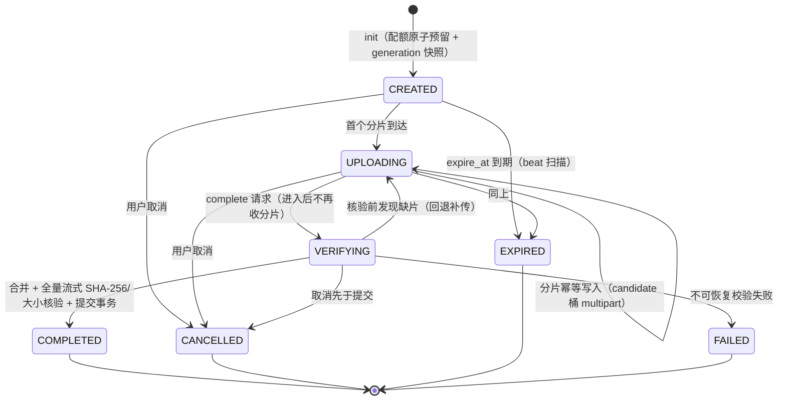

# 上传任务状态机（初稿，M0）

> 对应 PLAN §2.3。M6 编码实现，本图为设计基线；修订须同步《一页状态与一致性设计》。

## 规则要点

1. **终态不可复活**：COMPLETED / CANCELLED / EXPIRED / FAILED 之后任何分片/完成请求只读不写。
2. **COMPLETED 幂等**：重复 complete 返回同一 `result_version_id`（DB 已提交而响应丢失的恢复路径）。
3. **取消 vs 完成线性化**：两者在同一任务锁下排队——取消先提交则 complete 被拒（STATE_CONFLICT）；完成先提交则取消返回"已完成"，删除走文件删除流程。
4. **配额预留**：init 时原子条件更新 `used + reserved + size ≤ quota`，失败 5xxx；取消/过期/失败只释放一次。
5. **提交事务锁序统一**：空间额度 → 目标文件 → 任务 → 物理对象；提交前重检角色 / generation / 取消态 / 配额。
6. **秒传预检**（init 同接口）：仅当命中"本人个人空间可读、非回收站"的引用才返回 instant；跨用户一律完整上传，服务端核验后物理去重。
7. **候选对象**：分片与合并都在 candidate 桶不可变 key 上进行；提交成功后才成为正式引用；孤儿候选超 24h 宽限回收（M7 GC）。
8. **同名冲突**：完成时目标已改名/移动/删除/被抢先更新 → 409 + 保留限时任务，绝不静默覆盖。
